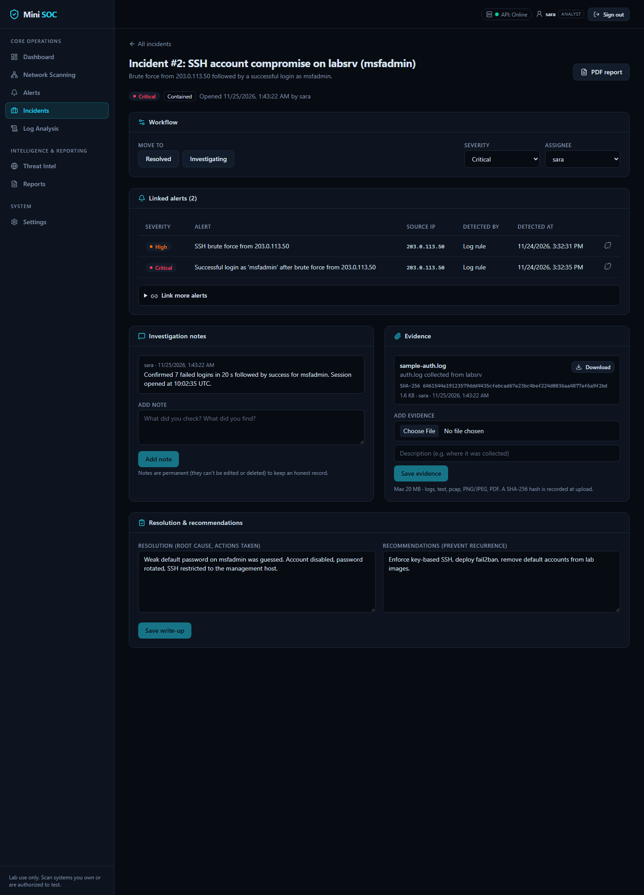
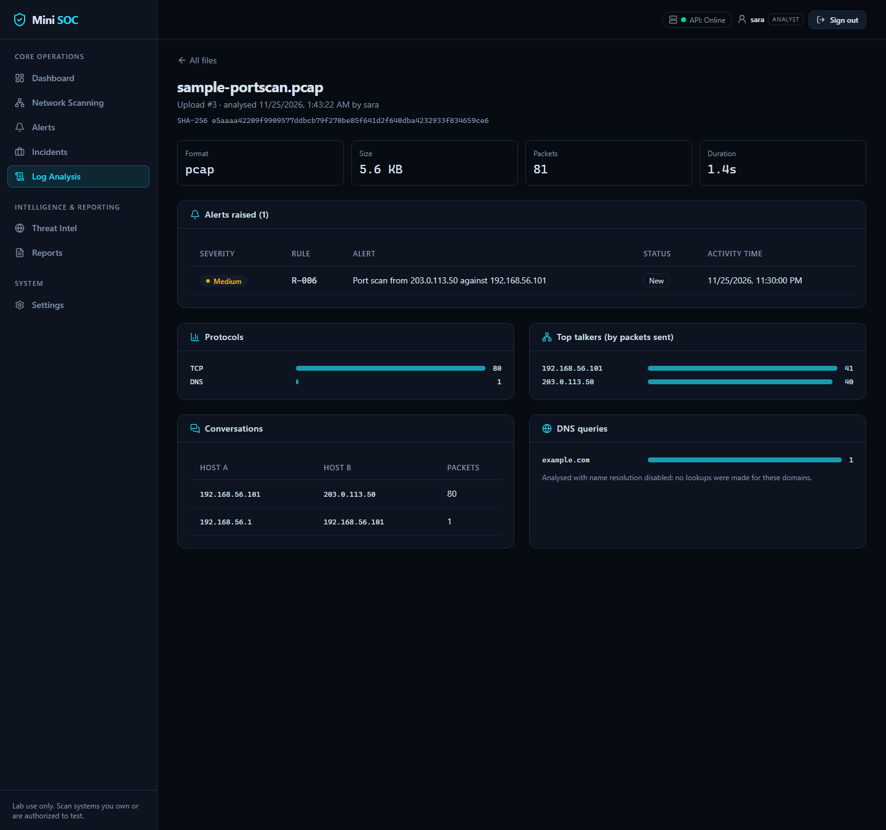

# Mini SOC

A lab-scale **Security Operations Center** web application, built as a cybersecurity portfolio project. It covers:

- discovering devices with **Nmap**,
- detecting attacks in **logs and packet captures** with transparent, MITRE-mapped rules,
- importing **Wazuh** SIEM alerts,
- triaging alerts and running **incident investigations** with notes, evidence and resolutions,
- enriching indicators with **threat intelligence**,
- exporting **PDF and CSV reports**.

> **Honesty by design:** every alert records which mechanism produced it, which rule fired, and where the evidence is. Simulated demo data is always flagged with a purple **DEMO** badge.



## Features

| Module | What it does |
|---|---|
| **Dashboard** | Live counts by severity and source, recent events, incident statistics, network inventory overview |
| **Network Scanning** | Nmap scans with preset profiles, **server-enforced scope** (default `192.168.56.0/24`), device and port inventory, exposure alerts, audit trail |
| **Alerts** | Filter and search, severity and status workflow, manual alerts, provenance panel, threat-intel pivot |
| **Incidents** | Built from alerts; assignment, NIST-style lifecycle, append-only notes, evidence with SHA-256, required resolution |
| **Log Analysis** | auth.log, Apache/Nginx and JSON-lines parsers; rules R-001 to R-005; pcap analysis with TShark (rule R-006) |
| **Threat Intel** | AbuseIPDB, VirusTotal and AlienVault OTX, showing each provider's verdict, score meaning, timestamp and reliability; 24 h cache |
| **Reports** | Incident PDF (timeline, indicators, evidence hashes, resolution), incident and alert CSV with injection protection |
| **Settings** | Users and roles, password management, scan scope, live integration status, Wazuh connection and sync, audit log |



## Tech stack

React 19 · Vite · Tailwind CSS v4 · Python 3.13 · FastAPI · SQLAlchemy · Alembic · SQLite · Argon2 · JWT (HttpOnly cookie) · Nmap · TShark · Wazuh · httpx · ReportLab · pytest · Git Bash automation

## Quick start (Windows / PowerShell)

You need Node.js 20+, Python 3.13 and Nmap. Wireshark (TShark) is optional and is only used for pcap analysis.

```powershell
# Backend (terminal 1)
cd backend
py -3.13 -m venv .venv
.venv\Scripts\Activate.ps1
pip install -r requirements-dev.txt
copy .env.example .env
python -c "import secrets; print(secrets.token_urlsafe(48))"   # paste as SECRET_KEY in .env
python -m scripts.create_admin                                   # choose your admin password
uvicorn app.main:app --reload --port 8000

# Frontend (terminal 2)
cd frontend
npm install
npm run dev
```

Open http://localhost:5173. Database migrations run automatically at startup.

Try it with the sample data:
- `python -m scripts.seed_demo_data` adds demo records, all flagged DEMO; `--remove` deletes them.
- Upload the files in [`samples/`](samples/) on the Log Analysis page.

## Testing

```powershell
cd backend; pytest; ruff check .; pip-audit -r requirements-dev.txt
cd ..\frontend; npm audit; npm run build
```

There are 120+ backend tests, including attack-style tests: forged JWTs, CSRF, command injection, XML entity attacks, disguised uploads, CSV/PDF injection, and out-of-scope scans. See [docs/TESTING.md](docs/TESTING.md) for a manual checklist covering every module.

## Documentation

- [Architecture](docs/ARCHITECTURE.md): design, data model, API overview
- [Security design and review](docs/SECURITY.md): threat model, controls, review findings
- [Detection rules](docs/DETECTION_RULES.md): logic, thresholds, MITRE ATT&CK mapping
- [Lab setup](docs/LAB_SETUP.md): VirtualBox host-only network and the Wazuh VM
- [Testing](docs/TESTING.md): automated tests and manual checks

## Project layout

```
frontend/     React single-page app
backend/      FastAPI service, detection engine, integrations, tests, migrations
automation/   Bash scripts: start-dev, database backup, Wazuh sync loop
samples/      Synthetic logs and pcap (documentation-range IPs) for trying the rules
docs/         Architecture, security, detection rules, lab setup, testing
```

## Ethics and scope

Mini SOC is for **lab use**. Scanning is restricted on the server to the VirtualBox host-only network (`192.168.56.0/24`) by default. Only scan systems you own or have explicit written permission to test. Private addresses are never sent to external threat-intelligence services.
